# 🎓 COLTECAGEM

> Simule um dia na vida de um estudante do COLTEC!

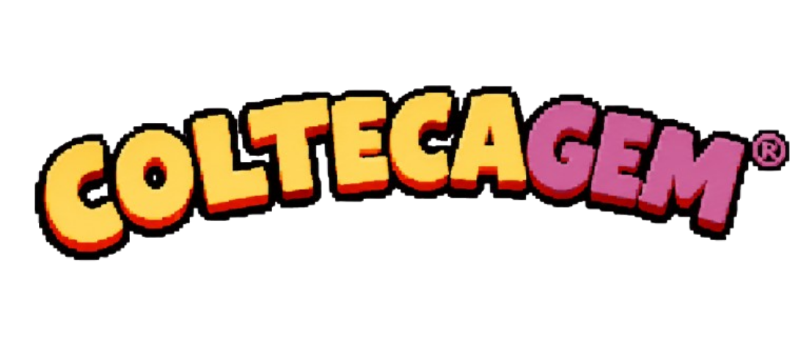

---

## 📖 Sobre o jogo

**Coltecagem** coloca o jogador na pele de um estudante do COLTEC durante um
dia de aula. O jogador anda pela escola, conversa com colegas e professores,
decide se vai à aula ou se fica pelos corredores e joga minijogos espalhados
pelo mapa. Cada escolha empurra seus atributos (energia, estresse, vida social
e desempenho acadêmico) para lados diferentes. Não existe um único caminho
"certo": o jogo tem **8 finais possíveis**, e o objetivo declarado (tirar nota
alta) muitas vezes entra em conflito com se manter saudável e ter amigos ao
longo do caminho.

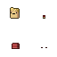

---

## 🎮 Como funciona

### O dia

O dia dura cerca de 10 minutos de jogo e tem **4 aulas**, com intervalos
entre elas. Um relógio na tela mostra o horário e o bloco atual. O jogador
anda livremente pelo pátio, pelo segundo andar, pelo terceiro andar e pela
sala de aula. No fim do dia há a **prova**.

### Atributos

| Atributo | Ícone | Efeito geral |
|---|---|---|
| Desempenho Acadêmico | 📚 | Sobe assistindo aula e em minijogos de estudo; decide aprovação e parte dos finais |
| Energia | ⚡ | Gasta com aula e com a maioria dos minijogos; recuperada comendo |
| Estresse | 😵 | Sobe com aula, estudo e prova; cai com minijogos de relaxar e de descarregar |
| Social | 🤝 | Sobe com conversas, minijogos sociais e matando aula |

Todos os atributos ficam sempre entre 0 e 100. Eles **só mudam por três
caminhos**: eventos do dia (aulas e prova), minijogos e escolhas nos diálogos.

### Aula: estar ou não estar na sala

Não há menu de ações. O jogo acompanha **onde o jogador está** durante cada
aula. O professor avisa que a aula vai começar; quem está dentro da sala
assiste (ganha desempenho, gasta energia e ganha estresse) e quem está fora
"mata" a aula (ganha social, perde desempenho). O efeito é proporcional ao
tempo que o jogador ficou dentro ou fora.

### Minijogos

O mapa tem **43 minijogos** espalhados em objetos e conversas com NPCs. Eles são
ilimitados e não gastam nenhuma ação, mas cada um tem uma **categoria** com
recompensas de troca (ganhar um atributo custa outro) e um **tempo de espera**
antes de poder jogar de novo:

| Categoria | Efeito ao vencer |
|---|---|
| Estudo | + desempenho, + estresse, − energia |
| Social | + social, − energia |
| Ação | + social, − estresse, − energia |
| Relaxar | − estresse, − um pouco de desempenho |
| Comida | + energia, − um pouco de social |
| Descarregar | − estresse, − energia |

Antes de cada minijogo, uma tela mostra o nome, os controles e o objetivo.
O `GerenciadorDeMinigames` pausa o dia, guarda a posição exata do personagem
e a restaura ao final. **Não existe "perder" de verdade**: vencer dá a
recompensa cheia e perder ainda dá metade, então o jogo nunca pune o jogador
com um Game Over por errar um minijogo.

### Prova e finais

A nota da prova depende do desempenho acadêmico acumulado, com um fator sorte.
Dependendo da combinação final de desempenho, estresse, energia e social, o
jogador recebe um dos 8 finais: Aluno Exemplar, Gênio Solitário, O Mais
Popular da Turma, Sobreviveu por Pouco, Vida Social em Primeiro Lugar,
Burnout Acadêmico, Repetente ou Formado na Média.

---

## 🖥️ Menu Inicial

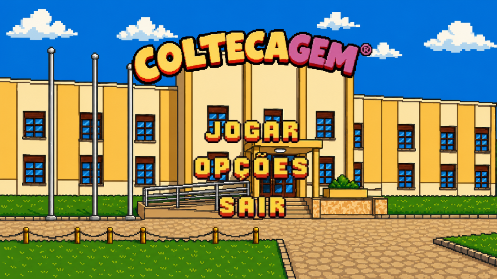

O menu principal contém as seguintes opções:

- **Jogar** — inicia a gameplay
- **Como jogar** — explica os controles, os atributos, as aulas e os minijogos
- **Opções** — abre o menu de configurações
- **Sair** — encerra o jogo

---

## ⚙️ Menu de Opções

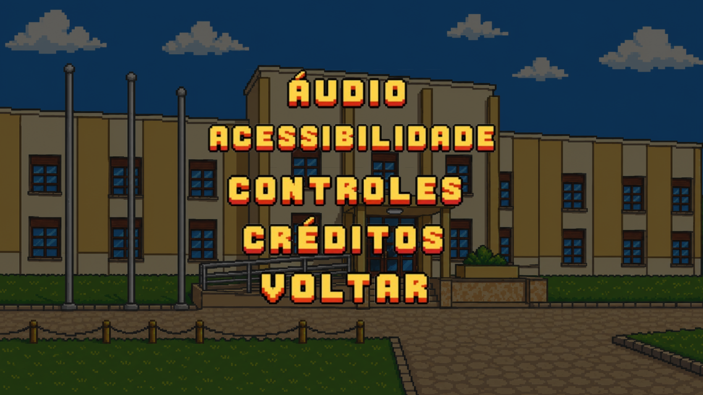

### 🔊 Áudio
Regulagem do volume do jogo.

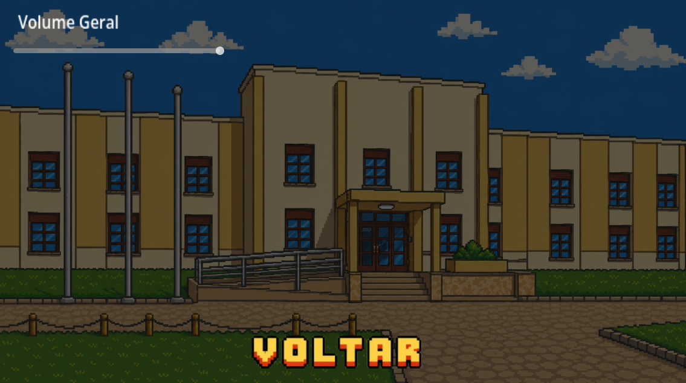

### ♿ Acessibilidade

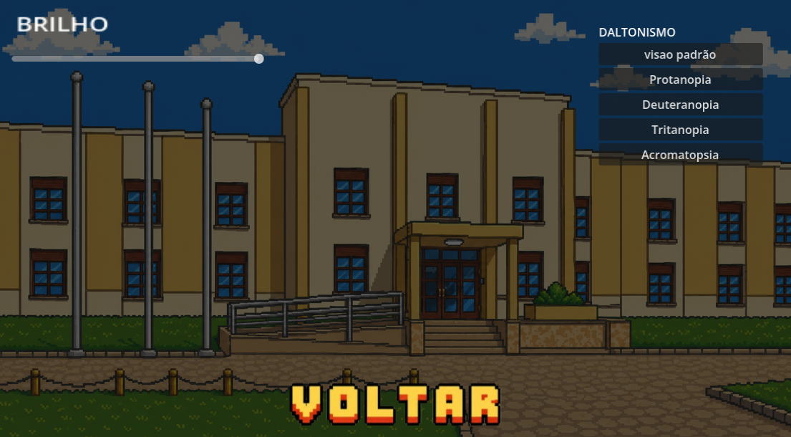

O jogo conta com um menu de acessibilidade próprio, sempre disponível a
partir do menu de Opções:

- **Brilho** — slider para ajustar o brilho geral da tela
- **Filtros de daltonismo** — simulação/correção para Protanopia,
  Deuteranopia, Tritanopia e Acromatopsia

| Protanopia | Deuteranopia | Tritanopia | Acromatopsia |
|------------|--------------|------------|--------------|
| 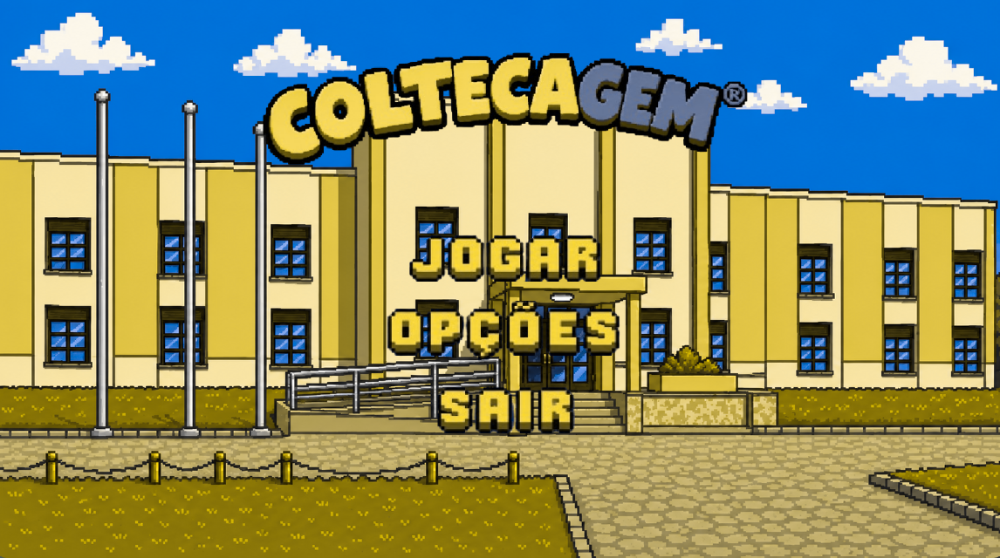 | 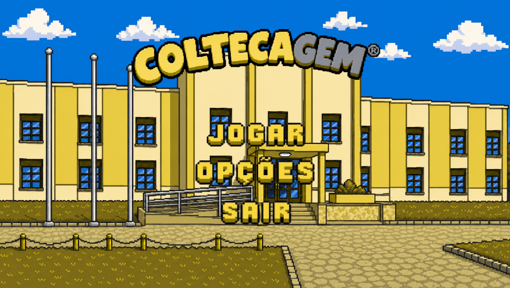 | 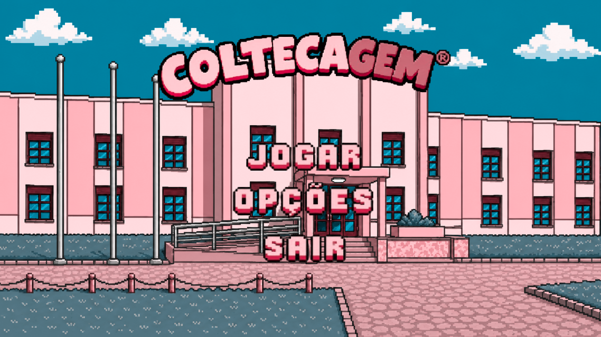 | 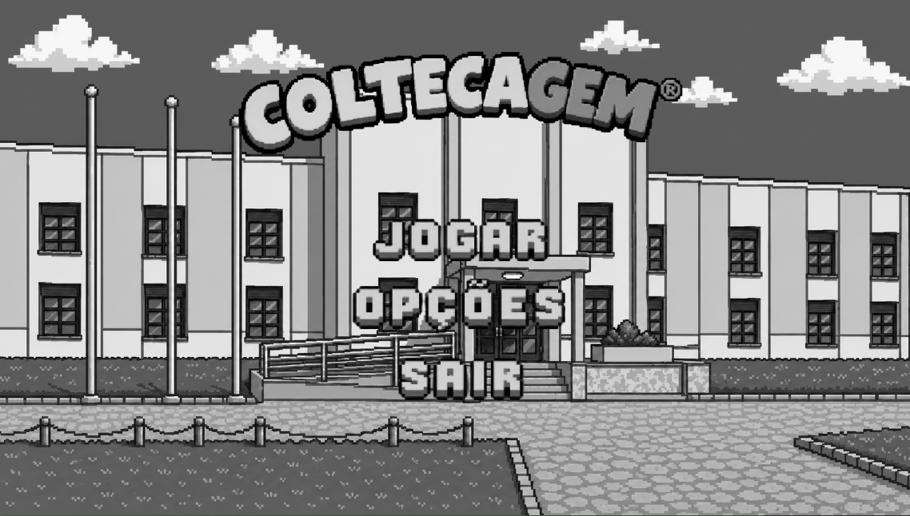 |

### 🎮 Controles
Configuração dos controles *(em desenvolvimento)*.

### 🏆 Créditos
Equipe de desenvolvimento e créditos de todo o material de terceiros usado
no jogo (a lista completa também está em
[CREDITOS_TERCEIROS.md](CREDITOS_TERCEIROS.md)).

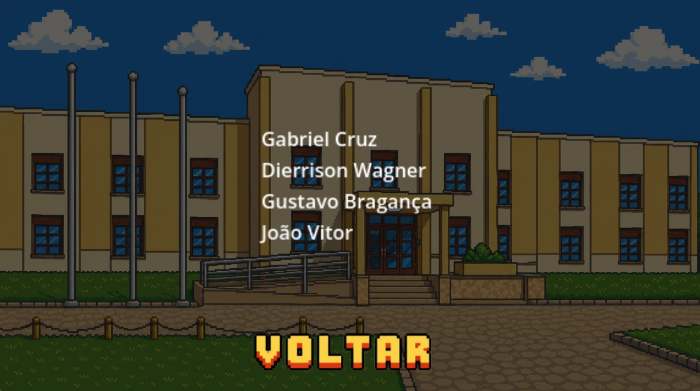

---

## 👤 Personagem Principal

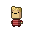

---

## 🗺️ Mapas

- **Pátio / Cantina** — área externa, cantina, quadra e portaria
- **Segundo andar** — corredor, escaninhos e quadro de avisos
- **Terceiro andar** — corredor que leva à sala de aula
- **Sala de Aula** — onde acontecem as aulas e a prova

---

## 🎯 Objetivo

Ao final da partida o jogador deverá alcançar uma média mínima para ser
aprovado (nota ≥ 60).

Entretanto, apenas estudar não é suficiente. Será necessário administrar
energia, estresse e relações sociais para conseguir bons resultados — e
para alcançar os finais alternativos do jogo.

---

## ▶️ Como rodar

1. Instale o [Godot 4.7](https://godotengine.org/download).
2. Clone este repositório e abra a pasta no Godot (`Import` → `project.godot`).
3. Aperte **Play** (F5). A cena inicial é o menu principal.

---

## 🧩 Créditos de terceiros

O jogo usa código, arte, sons e fontes de terceiros:

- **Minigame Madness** — 17 minijogos adaptados e convertidos para Godot 4
- **Librerama** — 24 nanogames (código GPL 3.0 ou posterior; arte e som CC BY-SA 4.0)
  · https://codeberg.org/Librerama/librerama
- **WarioWareGame**, de Bartosz Budnik (BudzioT), licença MIT — base de dois minijogos
- **Dialogue Manager**, de Nathan Hoad, licença MIT — sistema de diálogos
- **2D Classroom Asset Pack**, de Styloo — itens de sala de aula
- Fontes Press Start 2P (SIL OFL) e DejaVu Sans

A lista completa, com autor e licença de cada recurso, está em
[CREDITOS_TERCEIROS.md](CREDITOS_TERCEIROS.md) e também dentro do jogo
(Opções → Créditos). Por usar código GPL, o projeto é distribuído sob
**GPL 3.0 ou posterior**.

---

## 👥 Desenvolvedores

| Nome |
|------|
| Dierrisson Wagner |
| Gabriel Cruz |
| Gustavo Bragança |
| João Vitor Guerra |

---

*Desenvolvido para a disciplina — COLTEC 2026*
